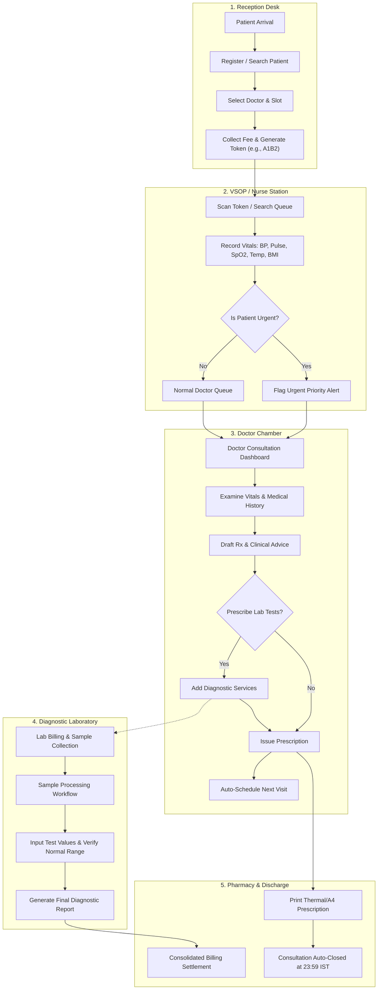
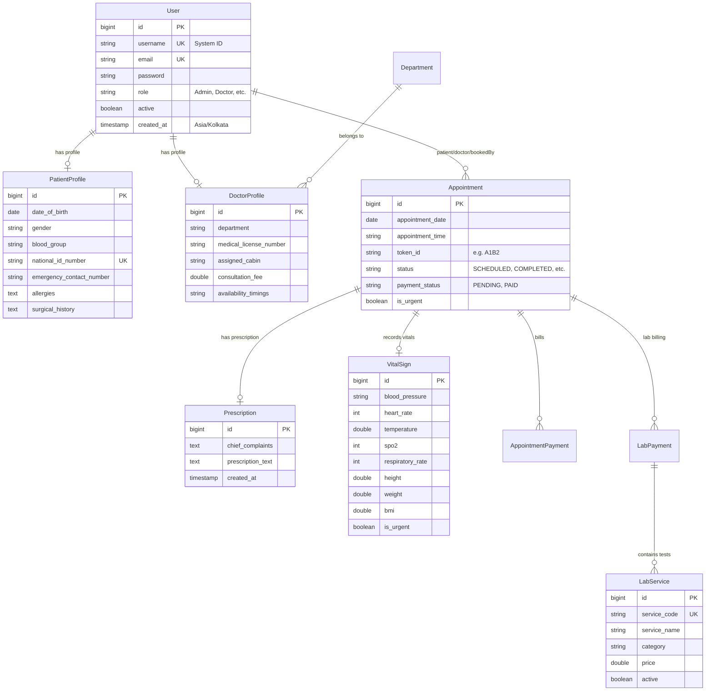

<!-- PROJECT LOGO & HEADER -->
<div align="center">

  
  
  # 🏥 Osa Care — Healthcare Ecosystem 2.0
  ### *Intelligent Hospital Information Management & Diagnostic Hub (HIMS)*

  <p align="center">
    A robust, enterprise-grade Hospital Management System engineered with <strong>Spring Boot</strong>, <strong>Thymeleaf</strong>, and <strong>Spring Data JPA</strong>. Designed for zero data loss, bulletproof double-billing prevention, real-time nurse triage, automated follow-up appointment extraction, and end-to-end dynamic laboratory reporting.
  </p>

  <!-- BADGES -->
  <p align="center">
    <a href="#"></a>
    <a href="#"></a>
    <a href="#"></a>
    <a href="#"></a>
    <a href="#"></a>
    <a href="#"></a>
  </p>

  <!-- QUICK ACTION BUTTONS -->
  <p align="center">
    <a href="#-quick-start"><b>🚀 Quick Start</b></a> •
    <a href="#-system-architecture"><b>🏗️ Architecture</b></a> •
    <a href="#-core-portals--role-walkthrough"><b>👥 Multi-Role Portals</b></a> •
    <a href="#-database-schema--erd"><b>🗄️ Database & ERD</b></a> •
    <a href="#-api--route-catalog"><b>⚡ Route Directory</b></a> •
    <a href="#-roadmap"><b>🗺️ Roadmap</b></a>
  </p>
</div>

---

## 📌 Executive Summary

Modern hospitals require frictionless inter-departmental collaboration. **Osa Care** bridges the gap between registration desks, triage nursing posts (VSOP), consultation chambers, diagnostic pathology labs, and administrative operations. 

By enforcing strict **Post-Redirect-Get (PRG)** design patterns across all payment and registration flows, Osa Care completely eliminates duplicate transactions and double-billing caused by accidental browser reloads or network retries.

```
       ┌────────────────┐
       │   Reception    │ ───► Books Appointment & Generates Token (e.g. A1B2)
       └───────┬────────┘
               │
               ▼
       ┌────────────────┐
       │  VSOP (Nurse)  │ ───► Scans Token & Records Vitals (BP, SpO2, BMI, Urgency)
       └───────┬────────┘
               │
               ▼
       ┌────────────────┐
       │ Doctor Station │ ───► Reviews Vitals, Prescribes Rx, AI Follow-Up Parsing
       └───────┬────────┘
               │
       ┌───────┴────────┐
       ▼                ▼
┌──────────────┐ ┌──────────────┐
│  Lab Portal  │ │  Dispensing  │ ───► Sample Queue, Test Verification, Final Invoices
└──────────────┘ └──────────────┘
```

---

## 🎯 Key Highlights

<table>
  <tr>
    <td width="50%">
      <h3>🛡️ PRG Pattern & Zero Data Loss</h3>
      <p>All sensitive operations (Patient Registration, Token Generation, Invoicing, Billing) adhere to the <b>Post-Redirect-Get (PRG)</b> pattern with Flash attributes. Refreshing pages never results in double-charges or duplicate database rows.</p>
    </td>
    <td width="50%">
      <h3>🩺 Smart VSOP & Scanner Station</h3>
      <p>Vital Signs Observation Post (VSOP) features a dedicated <b>Barcode / QR Scanner</b> interface to instantly pull up incoming patient tokens, log 8-point physiological vitals, and automatically flag high-risk triage cases.</p>
    </td>
  </tr>
  <tr>
    <td width="50%">
      <h3>🔬 Dynamic Laboratory Engine (LIMS)</h3>
      <p>Full sample lifecycle from <code>SAMPLE_COLLECTED</code> ➔ <code>PROCESSING</code> ➔ <code>COMPLETED</code>. Laboratory administrators can build dynamic JSON field schemas for test parameters with biological reference ranges.</p>
    </td>
    <td width="50%">
      <h3>🤖 Intelligent Follow-Up Parsing</h3>
      <p>Doctors can write prescription notes naturally. A built-in regex interpreter detects notations like <code>[Next Appointment: 2026-12-05 at 10:30 - FREE]</code> and automatically reserves follow-up slots in the hospital schedule.</p>
    </td>
  </tr>
  <tr>
    <td width="50%">
      <h3>⚡ Asynchronous Skeleton Loaders</h3>
      <p>Custom CSS/JS skeleton shimmer animations mask latency during heavy data hydration, delivering an instantaneous, app-like SPA feel across all hospital devices.</p>
    </td>
    <td width="50%">
      <h3>⏰ Automated Midnight Cron Scheduler</h3>
      <p>A background <code>@Scheduled</code> daemon executes every night at 23:59 IST to reconcile orphaned tokens, archive completed consultations, and reset daily queues cleanly.</p>
    </td>
  </tr>
</table>

---

## 🏗️ System Architecture

### 🔄 End-to-End Clinical Lifecycle

The diagram below illustrates the patient journey through the Osa Care ecosystem:



---

## 👥 Core Portals & Role Walkthrough

Click on each portal below to explore its specific capabilities, workflows, and security guardrails:

<details>
<summary><b>🛡️ 1. Administrator Command Center</b></summary>
<br>

The Admin Portal oversees system governance, staff provisioning, and organizational identity:

* **Hospital Branding & Customization**: Upload hospital logos dynamically, configure official email, telephone helpline, address, and license codes displayed across all invoices and prescription headers.
* **Role-Based User Provisioning**: Create and manage staff accounts across 8 specialized roles with auto-generated System IDs (`OSA-ADM-`, `OSA-DOC-`, `OSA-REC-`, `OSA-LAB-`, `OSA-VSP-`).
* **Medical Specialization / Department Directory**: Manage clinics and departments (e.g., Cardiology, Neurology, Orthopedics) with instant AJAX creation directly from the doctor onboarding modal.
* **Security & Access Control**: Instantly toggle account active status, execute administrative password resets, and audit user profiles. Self-deactivation safeguards prevent accidental admin lockout.

</details>

<details>
<summary><b>👨‍⚕️ 2. Doctor Consultation Chamber</b></summary>
<br>

Equipped with clinical decision-support tools and seamless patient history views:

* **Daily Appointment Queue**: Real-time listing of active tokens, completed visits, and upcoming consultations filtered by date.
* **Patient 360° Timeline**: Instant lookup of patient age calculation (Years-Months-Days), blood group, chief complaints, known allergies, surgical history, and previous consultation archives.
* **Embedded Triage Vitals**: Doctor views vitals captured by VSOP nurses directly inside the appointment screen with urgent case indicators.
* **Prescription Composer & Thermal Print**: Rich prescription editor with chief complaints, medication regimens, dosage instructions, and one-click print preview.
* **Auto Follow-Up Generator**: Writing `[Next Appointment: YYYY-MM-DD at HH:mm - FREE]` automatically registers the next visit in the appointment ledger with payment exemption.

</details>

<details>
<summary><b>📋 3. Reception & Billing Counter</b></summary>
<br>

Designed for high-throughput outpatient counters:

* **Rapid Patient Registration**: Capture full demographics, National ID (Aadhaar/SSN), emergency contact details, and past medical history.
* **Smart Doctor Slot Allocation**: Dynamic schedule selector displaying real-time doctor availability by day (Mon–Sun) and consultation time windows.
* **Dynamic Token Generator**: Auto-generates high-visibility alphanumeric tokens (e.g., `B4X9`) upon successful payment collection.
* **Billing & Invoices Engine**: Search by Token ID, Patient ID, or Phone Number to process payments via Cash, UPI, Card, or Net Banking with printable tax invoices.
* **Hospital ID Card Generator**: One-click generation of patient smart cards formatted with QR codes, personal details, and blood group.

</details>

<details>
<summary><b>🧪 4. Diagnostic Laboratory (LIMS)</b></summary>
<br>

An enterprise Laboratory Information Management System built directly into the core:

* **Diagnostic Catalog Management**: Configure test services, categories (Hematology, Biochemistry, Radiology, etc.), test codes, standard pricing, and estimated turn-around time (TAT).
* **Sample Tracking Queue**: Multi-stage state machine tracking each order through:
  `ORDERED` ➔ `BILLING_PAID` ➔ `SAMPLE_COLLECTED` ➔ `PROCESSING` ➔ `COMPLETED`.
* **Dynamic Report Configuration**: Customize JSON-based test parameters, unit measures (mg/dL, cells/mcL), and reference ranges (minimum, maximum, normal).
* **Automated Report Generation**: Clinical lab technicians record observed values; the system automatically highlights abnormal/critical flags and renders official PDF/print reports.

</details>

<details>
<summary><b>🩺 5. VSOP (Vital Signs Observation Post / Nurse Triage)</b></summary>
<br>

Triage station built for fast nursing workflows:

* **Barcode / QR Scanner**: Point-and-shoot camera integration to scan patient appointment tokens or wristbands without manual typing.
* **8-Point Vitals Matrix**:
  - Systolic & Diastolic Blood Pressure (mmHg)
  - Heart Rate / Pulse (BPM)
  - Body Temperature (°F / °C)
  - Oxygen Saturation (SpO2 %)
  - Respiratory Rate (breaths/min)
  - Height (cm) & Weight (kg) with **Automatic BMI Computation**
* **Emergency Triage Escalation**: Checkbox flag to mark critical vitals (`isUrgent = true`), immediately bumping the patient to the top of the doctor's queue.

</details>

<details>
<summary><b>👤 6. Patient, Pharmacy & Ancillary Portals</b></summary>
<br>

* **Patient Self-Service**: Portal for patients to view appointment history, active tokens, and historical test reports.
* **Pharmacy Counter**: Dispensing dashboard to review validated prescriptions directly from doctors.
* **Insurance & Helpdesk**: Dedicated dashboards for claims verification and patient support desk.

</details>

---

## 💻 Tech Stack & System Requirements

| Domain | Technology / Library | Version | Role in Ecosystem |
| :--- | :--- | :--- | :--- |
| **Language** | OpenJDK / Java | `21` / `25` | High-performance core runtime |
| **Framework** | Spring Boot | `4.0.3` | Application foundation, dependency injection |
| **Persistence** | Spring Data JPA / Hibernate | Latest | ORM, repository patterns, schema migrations |
| **Embedded DB** | H2 Database (File-Based) | `2.x` | Zero-setup local persistence (`AUTO_SERVER=TRUE`) |
| **Production DB**| MySQL Connector/J | `9.x` | Production-grade relational database engine |
| **View Engine** | Thymeleaf 3 | Latest | Server-rendered HTML templates with PRG safety |
| **Frontend UI** | HTML5 / CSS3 / Vanilla JS | — | Responsive skeleton UI, zero external bundle bloat |
| **Icons & Typography**| FontAwesome 6, Google Fonts | — | Medical UI icons, Poppins & Inter typography |
| **Task Scheduler**| Spring Scheduling (`@Scheduled`) | — | Cron-based midnight appointment reconciler |

---

## 🚀 Quick Start

### 📋 Prerequisites
* **Java Development Kit (JDK)**: Version 21 or 25 installed (`java -version`)
* **Apache Maven**: Version 3.8+ (or use the included `./mvnw` wrapper)
* **Git**: Installed on your system

### 1️⃣ Clone the Repository
```bash
git clone https://github.com/your-username/hospital-management-system.git
cd hospital-management-system
```

### 2️⃣ Configure Application Properties

By default, Osa Care runs on **H2 File Database** with zero installation required!

<details open>
<summary><b>Option A: Zero-Config H2 Database (Default)</b></summary>
<br>

The application is pre-configured in `src/main/resources/application.properties`:
```properties
server.port=8081

# File-based persistence in ./data/osacare
spring.datasource.url=jdbc:h2:file:./data/osacare;AUTO_SERVER=TRUE;DB_CLOSE_ON_EXIT=FALSE
spring.datasource.driverClassName=org.h2.Driver
spring.datasource.username=sa
spring.datasource.password=

# H2 Web Console
spring.h2.console.enabled=true
spring.h2.console.path=/h2-console

# Hibernate Auto DDL
spring.jpa.database-platform=org.hibernate.dialect.H2Dialect
spring.jpa.hibernate.ddl-auto=update
```
</details>

<details>
<summary><b>Option B: Switch to MySQL (Production Setup)</b></summary>
<br>

Create a MySQL database named `osacare`:
```sql
CREATE DATABASE osacare CHARACTER SET utf8mb4 COLLATE utf8mb4_unicode_ci;
```

Update `src/main/resources/application.properties`:
```properties
server.port=8081

spring.datasource.url=jdbc:mysql://localhost:3306/osacare?useSSL=false&serverTimezone=Asia/Kolkata&allowPublicKeyRetrieval=true
spring.datasource.username=root
spring.datasource.password=your_mysql_password
spring.datasource.driver-class-name=com.mysql.cj.jdbc.Driver

spring.jpa.database-platform=org.hibernate.dialect.MySQLDialect
spring.jpa.hibernate.ddl-auto=update
spring.jpa.show-sql=false
```
</details>

### 3️⃣ Build and Launch

Run the application using the included Maven wrapper:

```bash
# On Linux / macOS:
./mvnw clean spring-boot:run

# On Windows (Command Prompt / PowerShell):
.\mvnw.cmd clean spring-boot:run
```

Once the terminal outputs:
```
Started MyappApplication in X.XXX seconds (process running for X.XXX)
```

Open your browser and navigate to:
👉 **`http://localhost:8081`**

---

## 🔑 System IDs & Default Credentials

Osa Care enforces structured system identifiers across all roles:

| Role | System ID Format | Password Policy | Primary Dashboard URL |
| :--- | :--- | :--- | :--- |
| **Admin** | `OSA-ADM-XXXXXX` | Set on creation | `http://localhost:8081/admin/dashboard` |
| **Doctor** | `OSA-DOC-XXXXXX` | Default = System ID | `http://localhost:8081/doctor/dashboard` |
| **Receptionist** | `OSA-REC-XXXXXX` | Default = System ID | `http://localhost:8081/receptionist/dashboard` |
| **Diagnostic Lab** | `OSA-LAB-XXXXXX` | Default = System ID | `http://localhost:8081/lab/dashboard` |
| **VSOP (Nurse)** | `OSA-VSP-XXXXXX` | Default = System ID | `http://localhost:8081/vsop/dashboard` |
| **Patient** | `OSA-PAT-AAXXXXXXXX` | Set during sign-up | `http://localhost:8081/dashboard` |

> [!TIP]
> **First Run Tip**: You can register your first user via the `/signup` screen or check the H2 Console at `http://localhost:8081/h2-console` (JDBC URL: `jdbc:h2:file:./data/osacare`, User: `sa`, Password: empty).

---

## 🗄️ Database Schema & ERD

The entity architecture is normalized to guarantee transactional consistency and historical traceability:



---

## ⚡ API & Route Catalog

<details>
<summary><b>📂 Expand Full HTTP Endpoint Directory</b></summary>
<br>

### 🌐 Public & Authentication (`UserController`)
| Method | URI | Description |
| :--- | :--- | :--- |
| `GET` | `/` | Hospital landing page with skeleton loader |
| `GET` | `/login` | Authentication form (Supports 30-day "Remember Me" cookie) |
| `POST` | `/login` | Authenticate user & dispatch to role-specific dashboard |
| `GET` | `/signup` | Patient self-registration portal |
| `POST` | `/signup` | Submit registration & receive generated Patient ID |
| `POST` | `/logout` | Invalidate session & redirect to login |

### 🛡️ Administration Hub (`AdminController`)
| Method | URI | Description |
| :--- | :--- | :--- |
| `GET` | `/admin/dashboard` | Main admin KPI dashboard |
| `GET` | `/admin/users` | Manage all registered system users |
| `GET` | `/admin/users/create` | User creation form with department selector |
| `POST` | `/admin/users/create` | Provision new staff member with auto-generated ID |
| `POST` | `/admin/departments/add` | AJAX endpoint to dynamically add medical departments |
| `POST` | `/admin/users/toggle-status` | Toggle user active/inactive status |
| `POST` | `/admin/users/reset-password` | Reset staff credentials |
| `GET` | `/admin/settings` | Hospital branding & logo management |
| `POST` | `/admin/settings` | Upload hospital logo and update contact metadata |

### 👨‍⚕️ Doctor Station (`DoctorController`)
| Method | URI | Description |
| :--- | :--- | :--- |
| `GET` | `/doctor/dashboard` | Doctor overview and metrics |
| `GET` | `/doctor/appointments` | Filterable appointment queue by date |
| `GET` | `/doctor/appointment/{id}` | Clinical consultation screen (Vitals, Rx, History) |
| `POST` | `/doctor/appointment/save-prescription` | Save Rx & auto-create next follow-up appointment |
| `GET` | `/doctor/appointment/{id}/print-view` | Clean printable prescription layout |

### 📋 Reception & Billing Counter (`ReceptionistController`)
| Method | URI | Description |
| :--- | :--- | :--- |
| `GET` | `/receptionist/dashboard` | Reception desk KPI overview |
| `GET` | `/receptionist/register` | Patient registration form |
| `GET` | `/receptionist/appointments/new` | Book appointment & select doctor slot |
| `POST` | `/receptionist/billing/pay` | Process consultation payment & issue token |
| `GET` | `/receptionist/billing/receipt/{id}` | Render printable payment receipt |
| `GET` | `/receptionist/id-cards` | Search and print patient smart cards |

### 🧪 Diagnostic Lab Station (`LabController`)
| Method | URI | Description |
| :--- | :--- | :--- |
| `GET` | `/lab/dashboard` | Laboratory work queue |
| `GET` | `/lab/services` | Diagnostic test catalog |
| `POST` | `/lab/services/add` | Add diagnostic test with turnaround time |
| `GET` | `/lab/queue` | Sample collection and processing pipeline |
| `POST` | `/lab/sample/collect` | Mark sample collected with barcode tracking |
| `POST` | `/lab/report/generate` | Save test results & verify biological ranges |

### 🩺 VSOP Triage Station (`VsopController`)
| Method | URI | Description |
| :--- | :--- | :--- |
| `GET` | `/vsop/dashboard` | Nurse triage summary & urgent case counter |
| `GET` | `/vsop/scanner` | Camera-based barcode/QR scanner |
| `GET` | `/vsop/capture/{id}` | Vitals recording screen (BP, Pulse, SpO2, BMI) |
| `POST` | `/vsop/capture` | Save vitals and route patient to doctor queue |
| `GET` | `/vsop/logged-vitals` | Historical vitals audit trail |

</details>

---

## 🗺️ Roadmap & Feature Progress

- [x] Multi-Role Authentication with custom System ID nomenclature (`OSA-DOC-`, `OSA-PAT-`, etc.)
- [x] Strict Post-Redirect-Get (PRG) pattern across all registration & transaction controllers
- [x] Vital Signs Observation Post (VSOP) with BMI computation & camera barcode scanner
- [x] Dynamic Laboratory Information Management System (LIMS) with custom test schemas
- [x] Intelligent Prescription parser for automated follow-up appointment scheduling
- [x] Dynamic Hospital Branding & Logo upload serving directly via custom WebMvcConfigurer
- [x] Automated midnight cron reconciler (`@Scheduled`) for orphaned appointment tokens
- [ ] Multi-tenancy support for hospital chains & multi-branch healthcare centers
- [ ] Real-time SMS & WhatsApp alerts for appointment tokens and lab report readiness
- [ ] Telemedicine WebRTC video consultation module
- [ ] Integrated DICOM medical image viewer for radiological scans (X-Ray, CT, MRI)

---

## 🤝 Contributing

Contributions make the open-source community an incredible place to learn, inspire, and create. Any contributions you make are **greatly appreciated**.

1. Fork the Project
2. Create your Feature Branch (`git checkout -b feature/AmazingFeature`)
3. Commit your Changes (`git commit -m 'Add some AmazingFeature'`)
4. Push to the Branch (`git push origin feature/AmazingFeature`)
5. Open a Pull Request

---

## 📄 License

Distributed under the **MIT License**. See `LICENSE` for more information.

---

<div align="center">
  <p>Crafted with ❤️ for modern healthcare providers worldwide.</p>
  <p>
    <a href="#-osa-care--healthcare-ecosystem-20"><b>⬆ Back to Top</b></a>
  </p>
</div>
